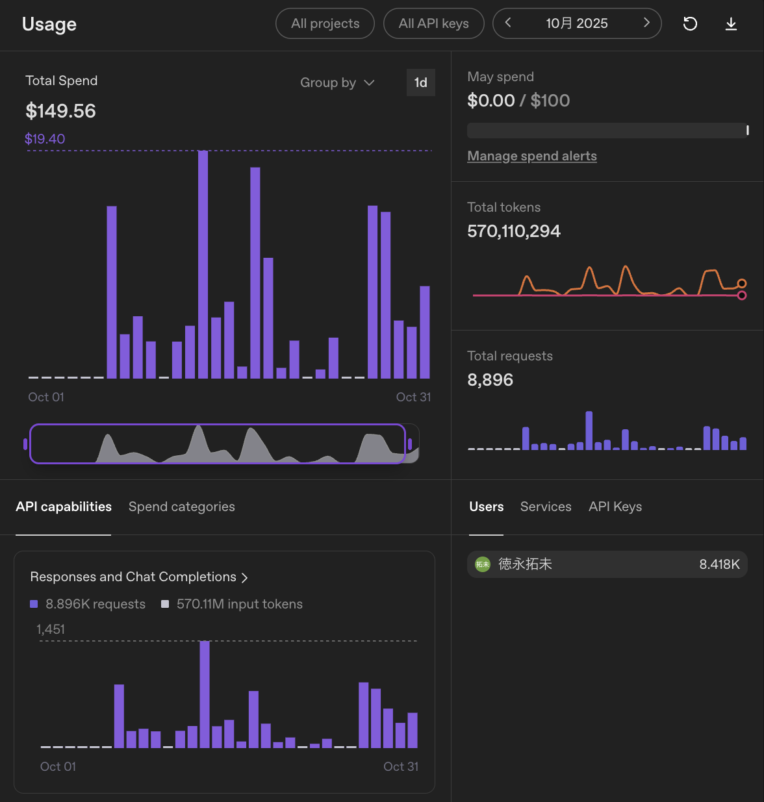

こんにちは、個人開発者のttokunagaです。

今回は、個人開発で利用しているAIサービスの構成と、2025年10月のAPI利用額を公開します。普段は月額サブスクリプションを使い、利用制限に達した場合や特定の自動化タスクではAPIを併用しています。

## 🤖 2025年10月のAI利用構成

| サービス | API支出 |
| --- | ---: |
| OpenAI API | \$149.56 |
| **合計** | **\$149.56** |

## 💸 集計の前提条件

APIの利用ダッシュボードに記録された従量課金額を集計しています。サブスク月額は含まず、日本円の参考額は1 USD = 150円で換算しています。

## 📊 OpenAI APIの利用量：約5.7億トークン、API利用額:\$149.56、割引率:0パーセント

### API利用額

| サービス | トークン数 | API利用額 |
| --- | ---: | ---: |
| OpenAI API | 約5.7億トークン | \$149.56 |

### 利用状況

| 項目 | 実績 |
| --- | ---: |
| 今月のAPI使用総額 | **\$149.56**（約22,400円） |
| 先月のAPI使用総額 | 記録なし |
| API累計使用金額 | **\$149.56**（2025年10月の記録開始から） |
| 今月の合計トークン数 | **約5.70億トークン** |
| 今月のリクエスト数 | **8,896件** |

この月は、AIをCoding Agentとして本格的に使い始めたタイミングでした。CodexやClineなどの拡張機能を試しながら、個人制作のコードを書いたり、既存コードの修正方針を相談したりしていました。

そのためOpenAI APIの利用が中心になり、入力トークンが非常に大きくなっています。長文コンテキストを渡してコードベースを読ませる使い方が多く、調査や整理というよりも「開発作業の横にAIを常駐させる」感覚に近い月でした。

**主な用途**: Codex / Cline を使った個人制作、実装相談、コード修正、バックグラウンド処理

この月はOpenAI APIにかなり寄せた運用でした。特にCoding Agentとして使うと、ファイル内容や周辺コードを何度も渡すため、思った以上に入力トークンが増えます。

一方で、実装の壁打ち相手としてはかなり便利でした。Clineのようなエディタ連携の体験も含めて、「AIにコードを書かせる」というより「AIと一緒に個人制作を進める」感覚をつかみ始めた月です。

### 利用状況の画像

*2025年10月はOpenAI APIだけで約5.70億トークンを利用しました*

---

## 📉 API利用額と実支払額

| サービス | API利用額 | 実支払額 |
| --- | ---: | ---: |
| OpenAI API | \$149.56 | \$149.56 |
| **合計** | **\$149.56** | **\$149.56** |

---

## 💡 まとめ

2025年10月のAPI課金は **\$149.56**でした。Coding Agentを個人制作に入れ始めたことで、API利用が一気に増えた月です。

今後はClaudeやGeminiも含めて、用途ごとにどのAPIが一番コストに見合うかを見ていきます。
