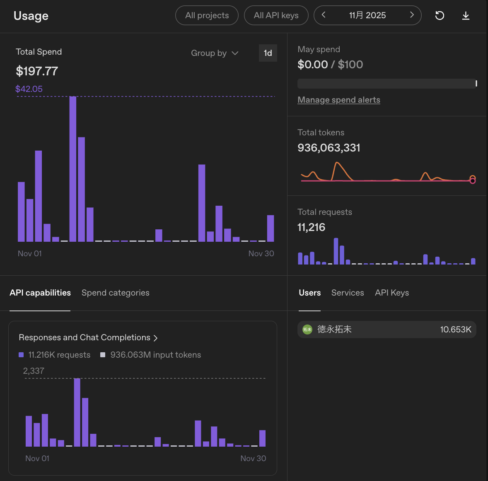

こんにちは、個人開発者のttokunagaです。

今回は、個人開発で利用しているAIサービスの構成と、2025年11月のAPI利用額を公開します。普段は月額サブスクリプションを使い、利用制限に達した場合や特定の自動化タスクではAPIを併用しています。

## 🤖 2025年11月のAI利用構成

| サービス | API支出 |
| --- | ---: |
| OpenAI API | \$197.77 |
| **合計** | **\$197.77** |

## 💸 集計の前提条件

APIの利用ダッシュボードに記録された従量課金額を集計しています。サブスク月額は含まず、日本円の参考額は1 USD = 150円で換算しています。

## 📊 OpenAI APIの利用量：約9.36億トークン、API利用額:\$197.77、割引率:0パーセント

### API利用額

| サービス | トークン数 | API利用額 |
| --- | ---: | ---: |
| OpenAI API | 約9.36億トークン | \$197.77 |

### 利用状況

| 項目 | 実績 |
| --- | ---: |
| 今月のAPI使用総額 | **\$197.77**（約29,700円） |
| 先月のAPI使用総額 | **\$149.56**（前月比: **+\$48.21**） |
| API累計使用金額 | **\$347.33**（2025年10月から） |
| 今月の合計トークン数 | **約9.36億トークン** |
| 今月のリクエスト数 | **11,216件** |

11月は10月よりもリクエスト数とトークン数が増え、APIコストも上がりました。個人制作でCoding Agent的に使う場面に加えて、大学のレジュメや講義資料をローカルで要約させたり、レポートの草案を書く用途でも使っていました。

コードだけでなく、授業資料や自分のメモをまとめる用途が増えたことで、長い入力を投げる回数が増えました。入力トークンの増加が、そのまま費用にも反映されています。

**主な用途**: 個人制作、大学レジュメの要約、レポート草案作成、ドキュメント要約

トークン数はかなり大きいですが、作業の流れを止めずに長文処理を回せるのは強いです。特に大学のレジュメを要約してから、自分の理解に合わせてレポートの草案へ展開する流れはかなり便利でした。

一方で、月額サブスクの感覚でAPIを使うとすぐに費用が積み上がります。勉強やレポート用途は長文になりやすいので、重い処理は本当にAPIでやる必要があるかを意識するようになりました。

### 利用状況の画像

*2025年11月はOpenAI APIで約9.36億トークンを利用しました*

---

## 📉 API利用額と実支払額

| サービス | API利用額 | 実支払額 |
| --- | ---: | ---: |
| OpenAI API | \$197.77 | \$197.77 |
| **合計** | **\$197.77** | **\$197.77** |

---

## 💡 まとめ

2025年11月のAPI課金は **\$197.77**でした。個人制作に加えて、大学の資料要約やレポート草案にも使い始めたことで、先月より増えました。

ただし、このあたりから「APIは便利だけど、何でも投げると普通に高い」という実感が出てきました。サブスクとAPIの使い分けは引き続き重要です。
