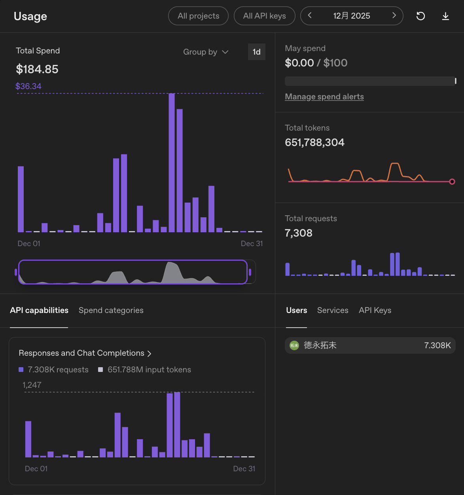

こんにちは、個人開発者のttokunagaです。

今回は、個人開発で利用しているAIサービスの構成と、2025年12月のAPI利用額を公開します。普段は月額サブスクリプションを使い、利用制限に達した場合や特定の自動化タスクではAPIを併用しています。

## 🤖 2025年12月のAI利用構成

| サービス | API支出 |
| --- | ---: |
| OpenAI API | \$184.85 |
| **合計** | **\$184.85** |

## 💸 集計の前提条件

APIの利用ダッシュボードに記録された従量課金額を集計しています。サブスク月額は含まず、日本円の参考額は1 USD = 150円で換算しています。

## 📊 OpenAI APIの利用量：約6.52億トークン、API利用額:\$184.85、割引率:0パーセント

### API利用額

| サービス | トークン数 | API利用額 |
| --- | ---: | ---: |
| OpenAI API | 約6.52億トークン | \$184.85 |

### 利用状況

| 項目 | 実績 |
| --- | ---: |
| 今月のAPI使用総額 | **\$184.85**（約27,700円） |
| 先月のAPI使用総額 | **\$197.77**（前月比: **-\$12.92**） |
| API累計使用金額 | **\$532.18**（2025年10月から） |
| 今月の合計トークン数 | **約6.52億トークン** |
| 今月のリクエスト数 | **7,308件** |

12月は研究室のプロジェクトでの利用が大半でした。プロジェクト関連の資料や実装内容を整理したり、方針を相談したりする場面で多く使っています。

それに加えて、大学のレポートの整合性確認にも使っていました。主張のつながりや説明の抜け漏れを確認しつつ、個人制作の実装補助にも引き続き使っていた月です。11月よりトークン数とリクエスト数は少し落ち着きましたが、まだかなり重めの使い方です。

**主な用途**: 研究室プロジェクト、レポートの整合性確認、個人制作、文章整理

11月より利用量は減りましたが、それでも6億トークンを超えています。研究室のプロジェクトでは、背景の説明や既存資料を含めて長めに投げることが多く、入力トークンが増えやすい使い方でした。

レポートの整合性確認でも、文章全体を見てもらうにはある程度まとまった文量が必要です。便利ではあるものの、サブスク側で済む作業と、APIで自動化したほうがよい作業の切り分けを少しずつ意識するようになりました。

### 利用状況の画像

*2025年12月はOpenAI APIで約6.52億トークンを利用しました*

---

## 📉 API利用額と実支払額

| サービス | API利用額 | 実支払額 |
| --- | ---: | ---: |
| OpenAI API | \$184.85 | \$184.85 |
| **合計** | **\$184.85** | **\$184.85** |

---

## 💡 まとめ

2025年12月のAPI課金は **\$184.85**でした。前月より少し下がったものの、研究室プロジェクト、レポート確認、個人制作を並行していたため、個人利用としてはまだ大きめです。

サブスクを主軸にしつつ、APIは自動化や長文処理のために使う。この方針自体は便利ですが、月次で振り返ると使いすぎの気配も見えてきます。
