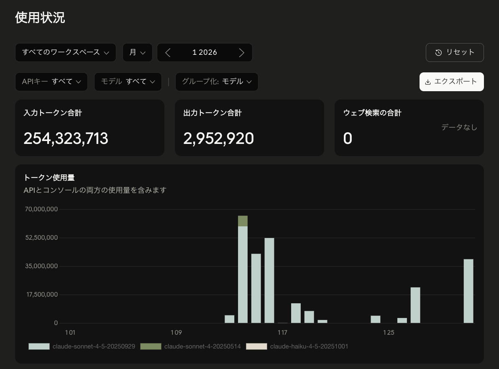
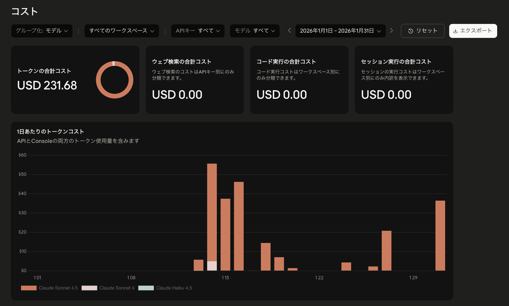

こんにちは、個人開発者のttokunagaです。

今回は、個人開発で利用しているAIサービスの構成と、2026年1月のAPI利用額を公開します。普段は月額サブスクリプションを使い、利用制限に達した場合や特定の自動化タスクではAPIを併用しています。

## 🤖 2026年1月のAI利用構成

| サービス | API支出 |
| --- | ---: |
| Anthropic API | \$231.68 |
| **合計** | **\$231.68** |

## 💸 集計の前提条件

APIの利用ダッシュボードに記録された従量課金額を集計しています。サブスク月額は含まず、日本円の参考額は1 USD = 150円で換算しています。

## 🤖 Anthropic APIの利用量：約2.57億トークン、API利用額:\$231.68、割引率:0パーセント

### API利用額

| サービス | トークン数 | API利用額 |
| --- | ---: | ---: |
| Anthropic API | 約2.57億トークン | \$231.68 |

### 利用状況

| 項目 | 実績 |
| --- | ---: |
| 今月のAPI使用総額 | **\$231.68**（約34,800円） |
| 先月のAPI使用総額 | **\$184.85**（前月比: **+\$46.83**） |
| API累計使用金額 | **\$763.86**（2025年10月から） |
| 今月の合計トークン数 | **約2.57億トークン** |
| 入力トークン数 | **約2.54億トークン** |
| 出力トークン数 | **約295万トークン** |

1月はAnthropic APIの利用が中心でした。期末レポートや大学のテスト勉強で使ったほか、Claude Codeを使って個人制作を進めていました。

トークン数だけを見ると前月より少ない一方、単価の影響でコストは増えています。学期末のアウトプットと個人制作が重なり、Claude系モデルを頼る場面が増えた月です。

**主な用途**: 期末レポート、テスト勉強、Claude Codeでの個人制作、リファクタリング

Claude系モデルは、コードの意図を汲み取ってもらいたい場面で安心感があります。Claude Codeを使った個人制作では、複数ファイルにまたがる修正方針や、実装の進め方を相談しながら作業できるのがかなり便利でした。

また、期末レポートやテスト勉強では、理解が曖昧な箇所を説明してもらったり、レポートの論理構成を確認してもらったりしていました。文章の自然さを重視したい場面でも頼りやすいです。

### 利用状況の画像

---

## 📉 API利用額と実支払額

| サービス | API利用額 | 実支払額 |
| --- | ---: | ---: |
| Anthropic API | \$231.68 | \$231.68 |
| **合計** | **\$231.68** | **\$231.68** |

---

## 💡 まとめ

2026年1月のAPI課金は **\$231.68**でした。期末レポート、テスト勉強、Claude Codeでの個人制作が重なったことで、Anthropic APIの利用が増えました。

高性能なモデルをAPIで使えるのはありがたいですが、重い相談を何度も投げる月は、サブスク側で済ませる作業との切り分けがより大事になります。
