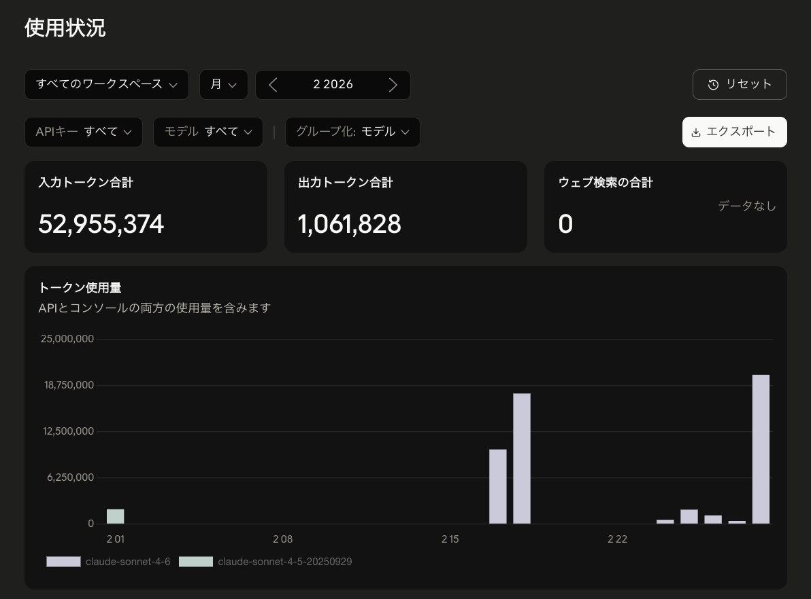
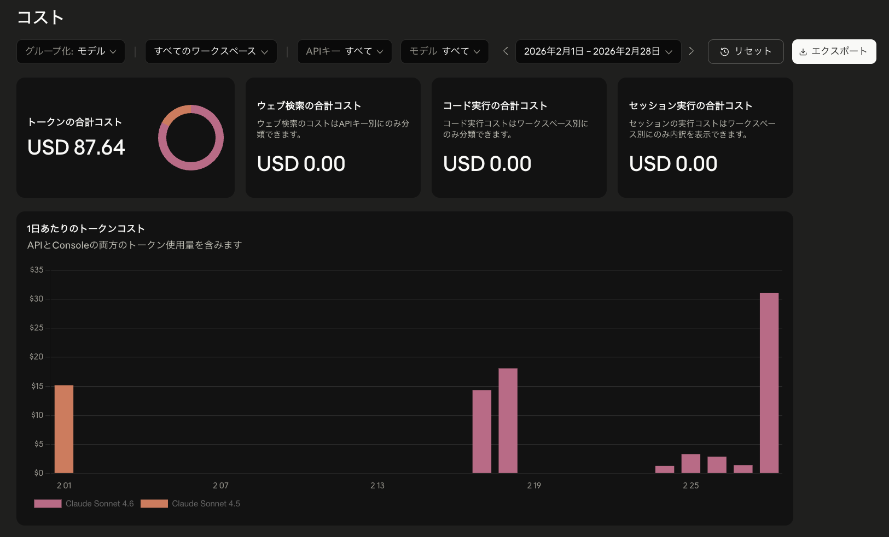

こんにちは、個人開発者のttokunagaです。

今回は、個人開発で利用しているAIサービスの構成と、2026年2月のAPI利用額を公開します。普段は月額サブスクリプションを使い、利用制限に達した場合や特定の自動化タスクではAPIを併用しています。

## 🤖 2026年2月のAI利用構成

| サービス | API支出 |
| --- | ---: |
| Anthropic API | \$87.64 |
| **合計** | **\$87.64** |

## 💸 集計の前提条件

APIの利用ダッシュボードに記録された従量課金額を集計しています。サブスク月額は含まず、日本円の参考額は1 USD = 150円で換算しています。

## 🤖 Anthropic APIの利用量：約5,402万トークン、API利用額:\$87.64、割引率:0パーセント

### API利用額

| サービス | トークン数 | API利用額 |
| --- | ---: | ---: |
| Anthropic API | 約5,402万トークン | \$87.64 |

### 利用状況

| 項目 | 実績 |
| --- | ---: |
| 今月のAPI使用総額 | **\$87.64**（約13,100円） |
| 先月のAPI使用総額 | **\$231.68**（前月比: **-\$144.04**） |
| API累計使用金額 | **\$851.50**（2025年10月から） |
| 今月の合計トークン数 | **約5,402万トークン** |
| 入力トークン数 | **約5,296万トークン** |
| 出力トークン数 | **約106万トークン** |

2月は1月より大きく利用量が減りました。Claude Codeを使いながら、Clineなどのエディタ拡張と比べた操作感の違いも少しずつ見えてきた月です。

Anthropic APIを使いつつも、重い処理の回数が減ったことでコストはかなり落ち着いています。実装の手触りとしては、Claude Codeの対話的な進めやすさと、Clineのエディタ上で完結する操作感の良さをそれぞれ感じていました。

**主な用途**: Claude Codeでの開発、Clineとの使い比べ、コードレビュー、設計相談

Claude系モデルは、相談の質が高いぶん「ここぞ」という場面に絞って使うと満足度が高いです。2月はClaude Codeの使用感を見ながら、Clineのような拡張機能の操作感の良さも再確認していました。

Claude Codeは、まとまった作業を対話しながら進めやすい一方、Clineはエディタの中で変更確認までつながる体験が分かりやすいです。2月はその使い分けを探っていた月でもあります。

### 利用状況の画像

---

## 📉 API利用額と実支払額

| サービス | API利用額 | 実支払額 |
| --- | ---: | ---: |
| Anthropic API | \$87.64 | \$87.64 |
| **合計** | **\$87.64** | **\$87.64** |

---

## 💡 まとめ

2026年2月のAPI課金は **\$87.64**でした。1月から大きく下がり、Claude CodeやClineを試しながらも、APIを必要な場面に絞るだけで月次コストがかなり変わることが分かります。

サブスクを普段使いの土台にして、APIは制限回避や自動化、重い処理のために使う。この運用が一番ストレスなく続けられそうです。
