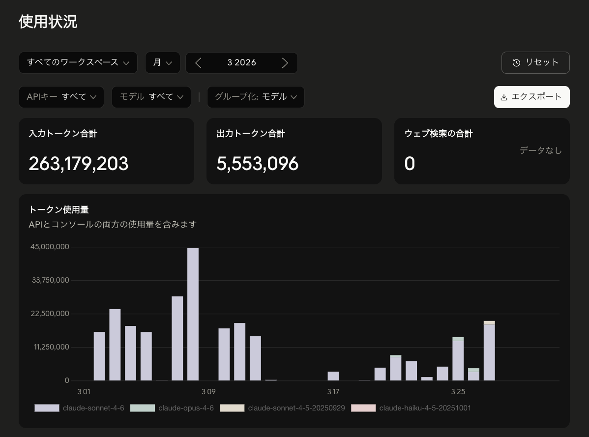
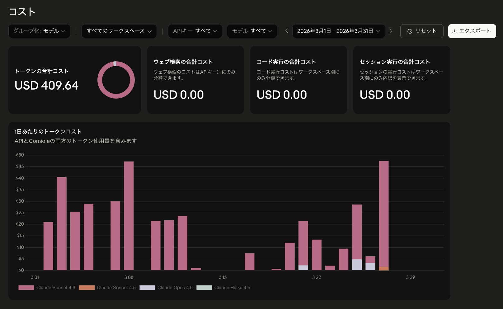
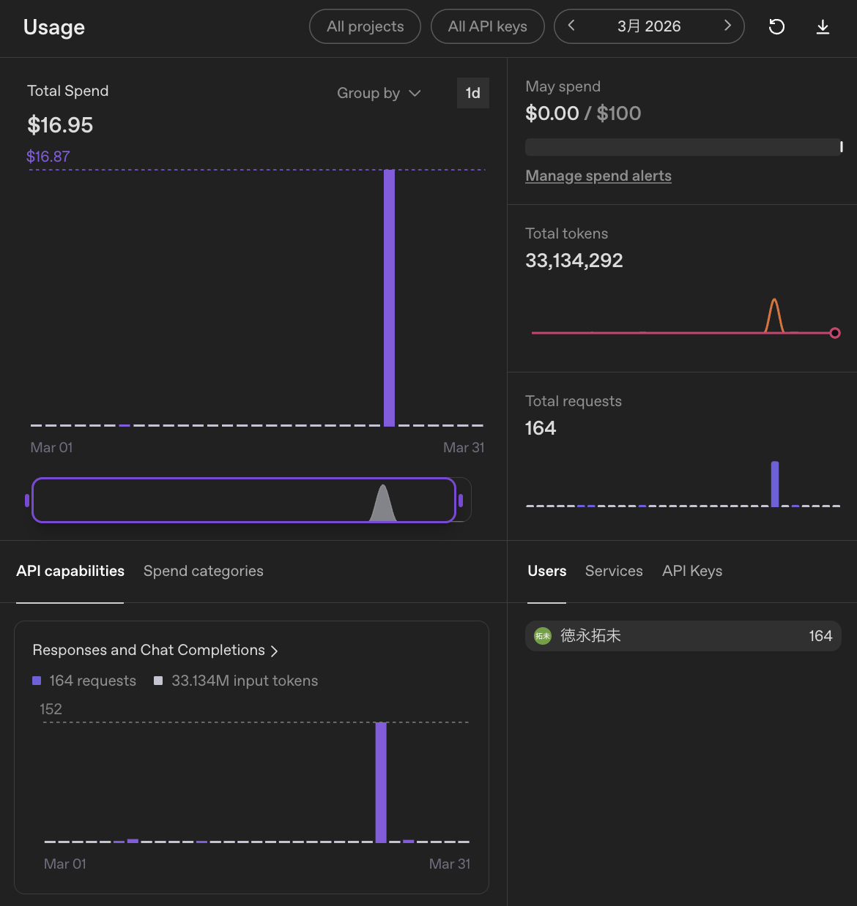

こんにちは、個人開発者のttokunagaです。

今回は、個人開発で利用しているAIサービスの構成と、2026年3月のAPI利用額を公開します。普段は月額サブスクリプションを使い、利用制限に達した場合や特定の自動化タスクではAPIを併用しています。

## 🤖 2026年3月のAI利用構成

| サービス | API支出 |
| --- | ---: |
| Anthropic API | \$409.64 |
| OpenAI API | \$16.95 |
| **合計** | **\$426.59** |

## 💸 集計の前提条件

APIの利用ダッシュボードに記録された従量課金額を集計しています。サブスク月額は含まず、日本円の参考額は1 USD = 150円で換算しています。

## 🤖 Anthropic APIの利用量：約2.69億トークン、API利用額:\$409.64、割引率:0パーセント

### API利用額

| サービス | トークン数 | API利用額 |
| --- | ---: | ---: |
| Anthropic API | 約2.69億トークン | \$409.64 |

### 利用状況

| 項目 | 実績 |
| --- | ---: |
| 今月のAPI使用総額 | **\$426.59**（約64,000円） |
| 先月のAPI使用総額 | **\$87.64**（前月比: **+\$338.95**） |
| API累計使用金額 | **\$1,278.09**（2025年10月から） |
| 今月の合計トークン数 | **約3.02億トークン** |

3月は大学の大型プロジェクトでの利用が中心でした。設計、実装、資料作成、方針整理など、プロジェクト全体を進めるためにAIをかなり使っています。

その結果、Anthropic APIの利用が大きく増え、これまでの記録の中でもかなり高い月になりました。OpenAI APIも使っていますが、費用の大部分はAnthropic側です。

この月あたりから、API課金が通常のサブスクよりも高額になってきました。そのため、APIを直接叩く運用から、Claudeの月額200ドルプラン（税抜\$200、日本の消費税10%込み\$220）と、ChatGPT Pro 20Xの月額30,000円プランへ切り替え、できるだけそちら経由で使う運用を始めました。

| 項目 | 実績 |
| --- | ---: |
| 入力トークン数 | **約2.63億トークン** |
| 出力トークン数 | **約555万トークン** |

**主な用途**: 大学の大型プロジェクト、設計相談、実装、リファクタリング、資料作成

Claude系モデルをかなり使った月です。大学の大型プロジェクトでは、複雑な実装や設計相談、資料作成、文章の推敲など、ほぼ毎日のように使っていました。

ただ、長いコンテキストを何度も投げるとコストが一気に伸びることも分かります。品質には満足している一方で、API課金のまま使い続けるには負担が大きくなってきました。

### 利用状況の画像

---

## 📊 OpenAI APIの利用量：約3,313万トークン、API利用額:\$16.95、割引率:0パーセント

### API利用額

| サービス | トークン数 | API利用額 |
| --- | ---: | ---: |
| OpenAI API | 約3,313万トークン | \$16.95 |

### 利用状況

| 項目 | 実績 |
| --- | ---: |
| 今月のリクエスト数 | **164件** |

**主な用途**: 軽めの補助処理、Responses / Chat Completions 経由の実験

3月のOpenAI APIは補助的な使い方でした。リクエスト数は少ないものの、まとまった入力を投げたためトークン数は3,000万を超えています。

### 利用状況の画像

*2026年3月のOpenAI API利用量です*

---

## 📉 API利用額と実支払額

| サービス | API利用額 | 実支払額 |
| --- | ---: | ---: |
| Anthropic API | \$409.64 | \$409.64 |
| OpenAI API | \$16.95 | \$16.95 |
| **合計** | **\$426.59** | **\$426.59** |

---

## 💡 まとめ

2026年3月のAPI課金は **\$426.59** でした。大学の大型プロジェクトでClaude系モデルを多めに使った結果、品質面の満足度は高い一方で、月次コストとしてはかなり重くなりました。

この月をきっかけに、Claudeの月額200ドルプラン（税抜\$200、日本の消費税10%込み\$220）とChatGPT Pro 20Xの月額30,000円プランを契約し、APIに直接流していた作業をできるだけサブスク経由へ移す方針に切り替えました。APIは必要な自動化や連携に絞って使っていきます。
