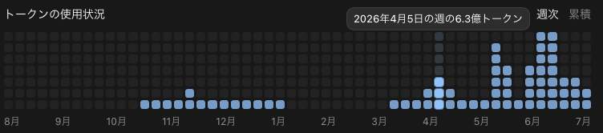
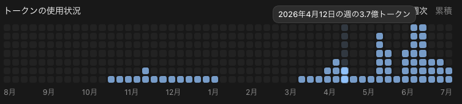
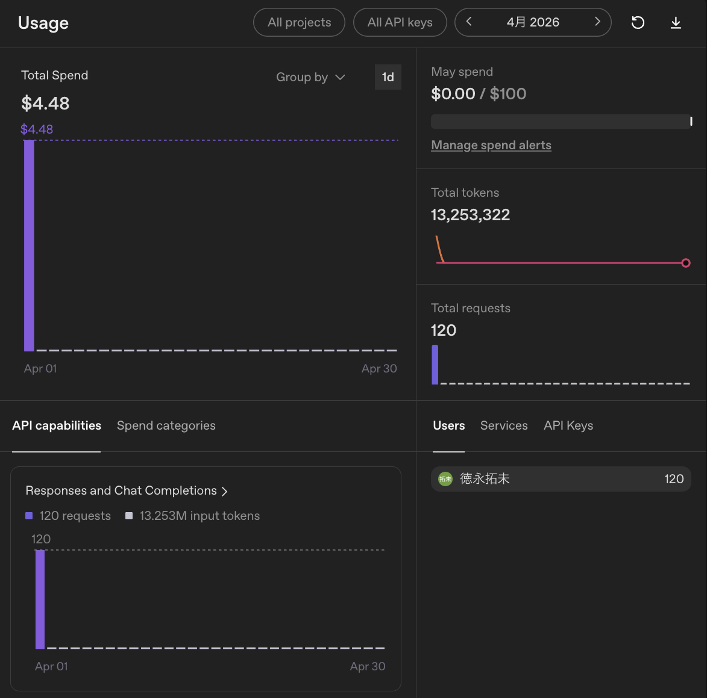

こんにちは、個人開発者のttokunagaです。

今回は、個人開発で利用しているAIサービスの構成と、2026年4月の利用量をAPI料金に換算した金額を公開します。

4月のCodexで確認できた月間トークン使用量は **約15.44億トークン** でした。API参考換算とOpenAI API利用額の合計は **\$916.12** で、支出は、この金額に対して **約77.68%OFF相当** でした。

## 🤖 2026年4月のAI利用構成

| サービス | 支出 |
| --- | ---: |
| ChatGPT Pro 20X | 30,000円 |

## 💸 API換算の前提条件

Codexの月間総量は公式APIから集計しました。モデル別・入出力別の構成には保存ログを使っています。

## 📊 Codexの利用量：約15億トークン、API参考換算額:約912ドル、割引率:78.1パーセント

Codexの確認できた利用量は **1,543,600,273トークン** です。

### モデル別API換算

モデル別のAPI参考換算は **\$911.64** です。

| モデル | トークン数 | API参考換算 |
| --- | ---: | ---: |
| GPT-5.5 | 1,350,000,000 | \$911.64 |
| **合計** | **1,350,000,000** | **\$911.64** |

### 入出力・キャッシュの割合

ローカルログからCodexの入出力・キャッシュの割合を計算しました。

| 区分 | 割合 |
| --- | ---: |
| 通常入力 | 2.40% |
| キャッシュ入力 | 97.37% |
| 出力 | 0.23% |
| キャッシュ出力 | 0.00% |

### 利用状況の画像

---

## 🔌 OpenAI APIの利用量：約1,325万トークン、API利用額:4.48ドル、割引率:0パーセント

OpenAI APIは **約1,325万トークン、120リクエスト** を利用しました。API利用額は **\$4.48** です。

### 利用状況の画像

---

## 📉 API換算額と実支払額

| サービス | API参考換算 | 実支払額 |
| --- | ---: | ---: |
| ChatGPT Pro 20X | \$911.64 | 30,000円 |
| OpenAI API | \$4.48 | \$4.48 |
| **合計** | **\$916.12** | **30,000円＋\$4.48** |

:::details 今回使用したモデルのAPI単価（100万トークンあたり、USD）

| モデル | 入力 | キャッシュ入力 | 出力 | キャッシュ出力 |
| --- | ---: | ---: | ---: | ---: |
| GPT-5.5 | \$5 / \$10 | \$0.50 / \$1 | \$30 / \$45 | — |

GPTの2値は通常／長文の順です。
:::

---

## 💡 まとめ

4月はChatGPT Pro 20Xを **30,000円**、OpenAI APIを **\$4.48** で利用しました。Codexの確認できた利用量は **約15.44億トークン** でした。

## 参考資料

* [GPT-5.5のモデル仕様とAPI料金](https://developers.openai.com/api/docs/models/gpt-5.5)
* [ChatGPT Proの料金とCodex利用](https://help.openai.com/en/articles/9793128-about-chatgpt-pro-plans)
