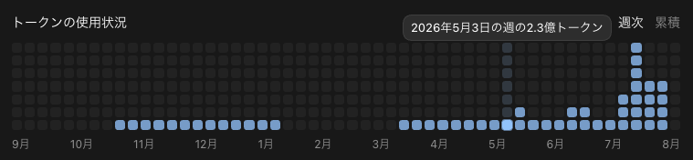
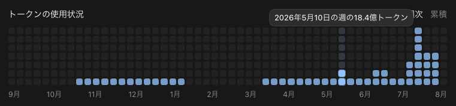
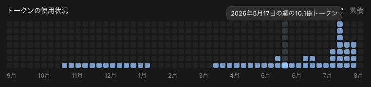
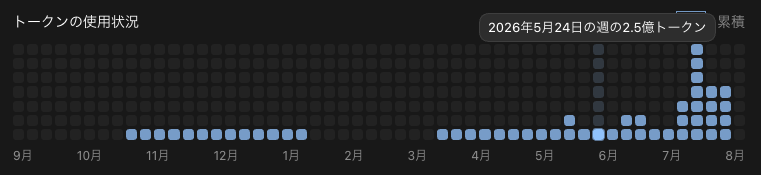
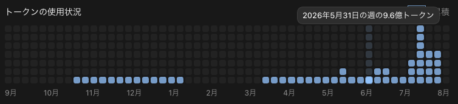
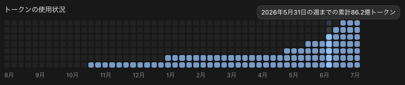

こんにちは、個人開発者のttokunagaです。

2026年5月のAI利用量と、API料金に換算した金額を公開します。

Codexの月間使用量は **約34.20億トークン**、API換算額は **\$2,896.98（約43.5万円）** でした。

ChatGPT Pro 20Xを利用しました。

---

## 🤖 AI利用構成

| サービス | サブスク支出 |
| --- | ---: |
| ChatGPT Pro 20X | 30,000円 |

---

## 📊 Codexの月間使用量

Codexの利用総量は **3,419,978,099トークン** です。

9月のGPT-5.6 Solの詳細ログにおける入出力の構成比は、次のとおりです。

| 区分 | 割合 |
| --- | ---: |
| 通常入力 | 2.4033% |
| キャッシュ読み取り | 97.3691% |
| キャッシュ書き込み | 0.0000% |
| 出力 | 0.2276% |
| **合計** | **100.0000%** |

月間総量はCodexの公式APIの日別値を合計しました。記事内のAPI換算額は、従来の集計にGPT-5.5の単価を適用した参考値です。

API換算額は「通常入力×通常単価＋キャッシュ読み取り×キャッシュ単価＋キャッシュ書き込み×書込単価＋出力×出力単価」を合計し、100万で割って計算しています。[OpenAIの公式料金表](https://developers.openai.com/api/docs/pricing)の2026年10月3日時点のStandard単価を使用しています。

| 価格適用モデル | 通常入力 | キャッシュ読み取り | キャッシュ書き込み | 出力 |
| --- | ---: | ---: | ---: | ---: |
| gpt-5.5 | \$5.00 | \$0.50 | — | \$30.00 |

単価は100万トークンあたりのUSDです。日本円では **約43.5万円** です。

### 利用状況の画像

*5月3日の週は2.3億トークンでした*

*5月10日の週は18.4億トークンでした*

*5月17日の週は10.1億トークンでした*

*5月24日の週は2.5億トークンでした*

*5月31日の週は9.6億トークンでした*

### 月末時点のCodex累計は86.2億トークン

---

## 📉 API換算額と実支払額

比較用レートは1 USD = 150円です。API換算額は実際の請求額ではありません。

| サービス | API換算額 | 実支払額 | 差額 | OFF相当率 |
| --- | ---: | ---: | ---: | ---: |
| ChatGPT Pro 20X | \$2,896.98 | 30,000円 | \$2,696.98 | 93.10% |
| **合計** | **\$2,896.98** | **30,000円** | **\$2,696.98** | **93.10%** |

API換算額に対して、実支払額は **約93.10%OFF相当** です。OFF相当率は「（1 − 実支払額 ÷ API換算額）× 100」で計算しています。

差額はAPI換算額とサブスク支出の比較値です。

---

## 💡 まとめ

5月のCodexの月間使用量は**約34.20億トークン**、API換算額は **\$2,896.98（約43.5万円）** でした。サブスク支出30,000円との差額は **\$2,696.98** です。

## 参考資料

* [GPT-5.5のモデル仕様とAPI料金](https://developers.openai.com/api/docs/models/gpt-5.5)
* [Introducing GPT-5.5](https://openai.com/index/introducing-gpt-5-5/)
* [ChatGPT Proの料金とCodex利用](https://help.openai.com/en/articles/9793128-about-chatgpt-pro-plans)
