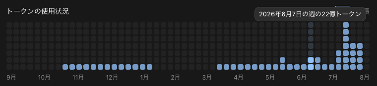
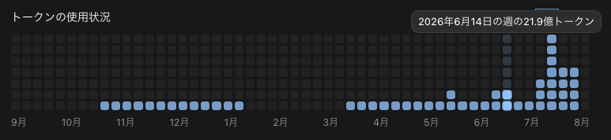
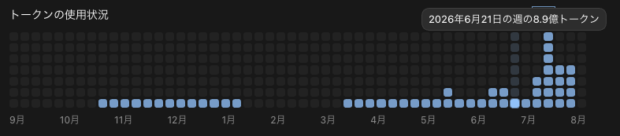
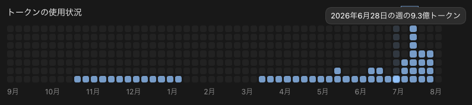
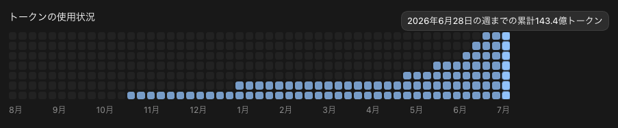
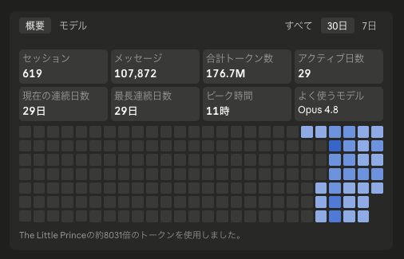

こんにちは、個人開発者のttokunagaです。

今回は、個人開発で利用しているAIサービスの構成と、2026年6月の利用量をAPI料金に換算した金額を公開します。

6月のCodexとClaude Codeで確認できた月間トークン使用量は、合計 **約66.42億トークン** でした。サブスクリプションの支出は **\$420** でした。

## 🤖 2026年6月のAI利用構成

| サービス | サブスク支出 |
| --- | ---: |
| ChatGPT Pro 20X | \$200 |
| Claude Max 20x | \$220 |
| **合計** | **\$420** |

## 💸 API換算の前提条件

[AI Usage](https://github.com/ttokunaga-ja/aiUsage)で集計しました。Codexは公式APIの日別総量に、同じ日の保存ログから得たモデル別・入出力別の構成比を配分しています。Claude Codeは利用記録の総量に入出力比率を仮定して換算しました。

## 📊 Codexの利用量：約65億トークン

Codexの確認できた利用量は **6,465,495,228トークン** です。

### モデル別API換算

公式APIで月間総量を取得しました。対応する日別ログがないため、モデル別内訳・API参考換算・入出力の割合は算出できません。

| モデル | トークン数 | API参考換算 |
| --- | ---: | ---: |
| 内訳不明 | 6,465,495,228 | — |
| **合計** | **6,465,495,228** | — |

### 入出力・キャッシュの割合

| 区分 | 割合 |
| --- | ---: |
| 通常入力 | — |
| キャッシュ入力 | — |
| 出力 | — |
| キャッシュ出力 | — |

### 利用状況の画像

---

## 🤖 Claude Codeの利用量：約1.77億トークン、API参考換算額:約377ドル、割引率:41.7パーセント

Claude Codeの利用記録で確認できた利用量は **176,700,000トークン** です。

### モデル別API換算

主に利用したClaude Opus 4.8の単価で、入出力比率を仮定したAPI参考換算は **\$377.25** です。

| モデル | トークン数 | API参考換算 |
| --- | ---: | ---: |
| Claude Opus 4.8（換算） | 176,700,000 | \$377.25 |
| **合計** | **176,700,000** | **\$377.25** |

### 入出力・キャッシュの割合

換算には次の比率を仮定しました。

| 区分 | 割合 |
| --- | ---: |
| 通常入力 | 20.00% |
| キャッシュ入力 | 77.00% |
| 出力 | 3.00% |
| キャッシュ出力 | 0.00% |

### 利用状況の画像

---

## 📉 API換算額とサブスク支出

| サービス | API参考換算 | サブスク支出 |
| --- | ---: | ---: |
| ChatGPT Pro 20X | — | \$200 |
| Claude Max 20x | \$377.25 | \$220 |
| **合計** | — | **\$420** |

:::details 今回使用したモデルのAPI単価（100万トークンあたり、USD）

| モデル | 入力 | キャッシュ入力 | 出力 | キャッシュ出力 |
| --- | ---: | ---: | ---: | ---: |
| Claude Opus 4.8 | \$5 | \$0.50 | \$25 | \$6.25 / \$10 |

Claudeのキャッシュ出力の2値は5分／1時間の順です。
:::

---

## 💡 まとめ

6月はChatGPT Pro 20XとClaude Max 20xを合計 **\$420** で利用しました。Codexの確認できた利用量は **約64.65億トークン**、Claude Codeの利用記録は **約1.77億トークン** でした。

## 参考資料

* [GPT-5.5のモデル仕様とAPI料金](https://developers.openai.com/api/docs/models/gpt-5.5)
* [ChatGPT Proの料金とCodex利用](https://help.openai.com/en/articles/9793128-about-chatgpt-pro-plans)
* [Claude Opus 4.8のAPI料金](https://platform.claude.com/docs/en/about-claude/pricing)
* [Claude Maxの料金](https://support.claude.com/ja/articles/11049741-max-%E3%83%97%E3%83%A9%E3%83%B3%E3%81%A8%E3%81%AF%E4%BD%95%E3%81%A7%E3%81%99%E3%81%8B)
