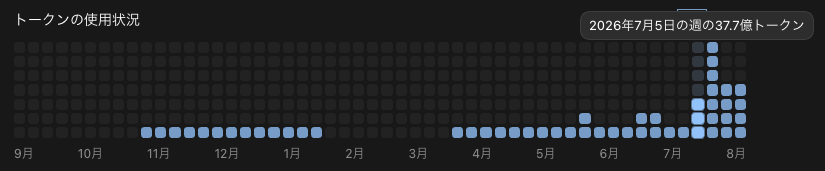
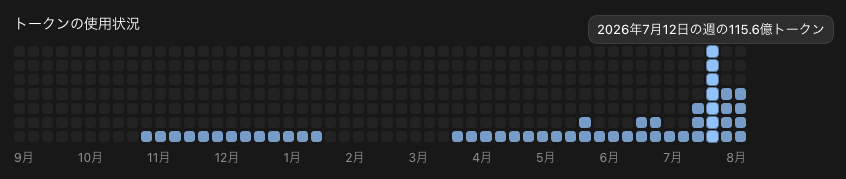
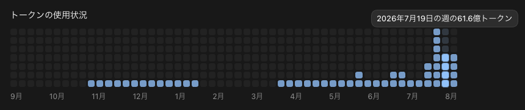
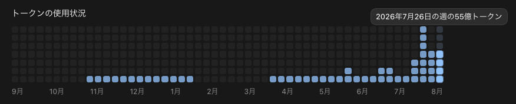
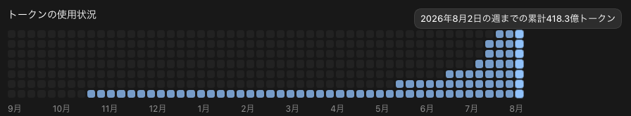
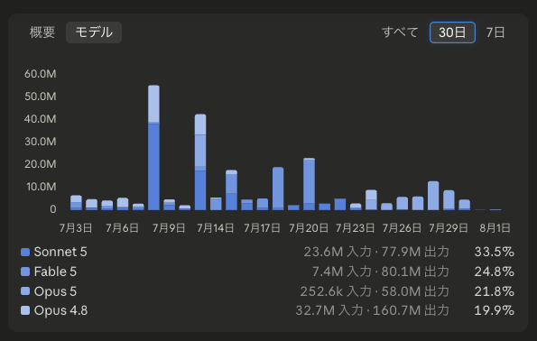

こんにちは、個人開発者のttokunagaです。

今回は、個人開発で利用しているAIサービスの構成と、2026年7月の利用量をAPI料金に換算した金額を公開します。

7月のCodexとClaude Codeで確認できた月間トークン使用量は、合計 **約328.54億トークン** でした。API参考換算額は **\$17,918.96** で、サブスクリプションの支出は、この換算額に対して **約97.66%OFF相当** でした。

## 🤖 2026年7月のAI利用構成

| サービス | サブスク支出 |
| --- | ---: |
| ChatGPT Pro 20X | 30,000円 |
| Claude Max 20x | \$220.00（税込） |

## 💸 API換算の前提条件

[AI Usage](https://github.com/ttokunaga-ja/aiUsage)で集計しました。Codexの月間総量は公式APIから集計しました。モデル別・入出力別の構成には保存ログを使っています。Claude Codeは7月1日から8月1日までの保存ログを集計しました。

## 📊 Codexの利用量：約277億トークン、API参考換算額:約14,335ドル、割引率:98.6パーセント

Codexの確認できた利用量は **27,650,461,982トークン** です。

### モデル別API換算

モデル別のAPI参考換算は **\$14,335.07** です。

| モデル | トークン数 | API参考換算 |
| --- | ---: | ---: |
| GPT-5.6 Sol | 26,990,000,000 | \$14,335.07 |
| **合計** | **26,990,000,000** | **\$14,335.07** |

### 入出力・キャッシュの割合

ローカルログからCodexの入出力・キャッシュの割合を計算しました。

| 区分 | 割合 |
| --- | ---: |
| 通常入力 | 2.40% |
| キャッシュ入力 | 97.37% |
| 出力 | 0.23% |
| キャッシュ出力 | 0.00% |

### 利用状況の画像

---

## 🤖 Claude Codeの利用量：約52億トークン、API参考換算額:約3,584ドル、割引率:93.9パーセント

Claude Codeの保存ログで確認できた利用量は **5,203,768,396トークン** です。

### モデル別API換算

モデル別のAPI参考換算は **\$3,583.88** です。

| モデル | トークン数 | API参考換算 |
| --- | ---: | ---: |
| Claude Fable 5 | 60,956,825 | \$293.25 |
| Claude Haiku 4.5 | 10,522,538 | \$1.73 |
| Claude Opus 4.8 | 959,494,528 | \$875.58 |
| Claude Opus 5 | 3,138,423,577 | \$2,080.34 |
| Claude Sonnet 5 | 1,034,370,928 | \$332.98 |
| **合計** | **5,203,768,396** | **\$3,583.88** |

### 入出力・キャッシュの割合

保存ログからClaude Codeの入出力・キャッシュの割合を計算しました。

| 区分 | 割合 |
| --- | ---: |
| 通常入力 | 0.02% |
| キャッシュ入力 | 97.70% |
| 出力 | 0.41% |
| キャッシュ出力 | 1.87% |

### 利用状況の画像

---

## 📉 API換算額とサブスク支出

| サービス | API参考換算 | サブスク支出 |
| --- | ---: | ---: |
| ChatGPT Pro 20X | \$14,335.07 | 30,000円 |
| Claude | \$3,583.88 | \$220.00（税込） |
| **合計** | **\$17,918.96** | **30,000円＋\$220.00** |

:::details 今回使用したモデルのAPI単価（100万トークンあたり、USD）

| モデル | 入力 | キャッシュ入力 | 出力 | キャッシュ出力 |
| --- | ---: | ---: | ---: | ---: |
| GPT-5.6 Sol | \$4 / \$8 | \$0.40 / \$0.80 | \$20 / \$30 | \$5 / \$10 |
| Claude Fable 5 | \$10 | \$1 | \$50 | \$12.50 / \$20 |
| Claude Haiku 4.5 | \$1 | \$0.10 | \$5 | \$1.25 / \$2 |
| Claude Opus 4.8 | \$5 | \$0.50 | \$25 | \$6.25 / \$10 |
| Claude Opus 5 | \$5 | \$0.50 | \$25 | \$6.25 / \$10 |
| Claude Sonnet 5 | \$2 | \$0.20 | \$10 | \$2.50 / \$4 |

GPTの2値は通常／長文、Claudeのキャッシュ出力の2値は5分／1時間の順です。
:::

---

## 📰 2026年7月のAIニュースと所感

### GPT-5.6 Lunaの価格が80%下がり、価格の下限が一気に下がった

OpenAIは7月9日、GPT-5.6 Sol、Terra、LunaをChatGPT、Codex、APIへ展開しました。開始時点の通常入力・出力料金は、100万トークンあたりSolが **\$5 / \$30**、Terraが **\$2.50 / \$15**、Lunaが **\$1 / \$6** でした。

その後OpenAIは[7月30日の価格改定](https://openai.com/index/advancing-the-price-performance-frontier-with-gpt-5-6/)で、Terraを **\$2 / \$12**へ20%値下げし、Lunaを **\$0.20 / \$1.20**へ80%値下げしました。Lunaのキャッシュ入力は **\$0.02** です。Solの価格は変わっていません。

### LunaはGemini最安のFlash-Liteより安い

[Gemini APIの料金表](https://ai.google.dev/gemini-api/docs/pricing)で現行GAモデルの最安となるGemini 3.5 Flash-Liteは、通常入力 **\$0.30**、出力 **\$2.50**、キャッシュ入力 **\$0.03** です。改定後のGPT-5.6 Lunaは **\$0.20 / \$1.20 / \$0.02**なので、入力とキャッシュ入力が約**33.3%安く**、出力は**52%安い**計算になります。

Googleの主力であるGemini 3.6 Flashの\$1.50 / \$7.50と比べると、Lunaは入力が約**86.7%安く**、出力が**84%安い**価格です。Geminiの最安モデルよりもLunaのほうが安くなったため、**価格だけを理由にGeminiを選ぶ意味はほぼなくなりました**。

### Geminiの存在意義はほとんどなくなった

コード生成やエージェント用途では、GPT-5.6ファミリーの性能と価格によって、Geminiを選ぶ理由はほぼなくなったと考えています。OpenAIの同一ファミリー内で、難しい仕事はSol、量を回す仕事はTerraやLuna、さらに単純な大量処理はGPT-5 nanoへ切り替えられるためです。

残る可能性があるのは、Geminiが得意としてきたネイティブなマルチモーダル処理です。今後、私がGeminiを使うとすれば、汎用的なコーディングではなく次の領域に限られます。

- スキャン画像や写真からのOCR、帳票の構造化
- PDF、画像、音声、動画をまとめて扱う処理
- 図表や画面レイアウトを読むマルチモーダル推論
- Google SearchやMapsとのグラウンディング

言い換えると、Geminiは「安い汎用モデル」という立ち位置を失い、存在意義は**マルチモーダル性能を生かしたOCR・文書理解などの限定的な用途**にほぼ絞られました。ここでもOpenAI側の画像・文書処理が追いつけば、私のAIスタックからGeminiが外れる可能性は高いと見ています。

### Claudeも7月にモデル構成が大きく変わった

Anthropicは7月1日にFable 5へのアクセスを再開し、7月24日にはClaude Opus 5を公開しました。Opus 5はOpus 4.8と同じ入力\$5・出力\$25で提供されています。また、Sonnet 5には8月31日まで入力\$2・出力\$10の導入価格が設定されています。

保存ログにはSonnet 5、Fable 5、Opus 5、Opus 4.8、Haiku 4.5が記録されています。とくにOpus 5は月末に登場したモデルで、出力は**約660万トークン**、キャッシュ読み取りは**約30.95億トークン** でした。

### Codexは週100億トークン時代に入った

今月もっとも驚いたのは、新モデルのベンチマークよりも自分の利用量でした。7月12日の週だけで115.6億トークンが画面に表示されました。

利用枠のリセットが多いと、作業を継続できる反面、同じプロジェクトのコンテキストを何度も読み直す機会も増えます。今後は単に「何トークン使えたか」だけでなく、リセットやコンパクションを挟んでも成果物へつながったか、同じ情報を再投入しすぎていないかも見ていく必要があります。

---

## 💡 まとめ

7月はChatGPT Pro 20Xを **30,000円**、Claude Max 20xを **\$220.00（税込）** で利用しました。

Codexの確認できた利用量は **約276.50億トークン**、Claude Codeの保存ログは **約52.04億トークン** でした。

## 参考資料

* [GPT-5.6: Frontier intelligence that scales with your ambition](https://openai.com/index/gpt-5-6/)
* [Advancing the price-performance frontier with GPT-5.6](https://openai.com/index/advancing-the-price-performance-frontier-with-gpt-5-6/)
* [GPT-5.6 Lunaのモデル仕様とAPI料金](https://developers.openai.com/api/docs/models/gpt-5.6-luna)
* [Gemini Developer APIの料金](https://ai.google.dev/gemini-api/docs/pricing)
* [ChatGPT Proの料金とCodex利用](https://help.openai.com/en/articles/9793128)
* [Claude Platformのモデル別API料金](https://platform.claude.com/docs/en/about-claude/pricing)
* [Claude Maxの料金](https://support.claude.com/ja/articles/11049741-max-%E3%83%97%E3%83%A9%E3%83%B3%E3%81%A8%E3%81%AF%E4%BD%95%E3%81%A7%E3%81%99%E3%81%8B)
* [Redeploying Claude Fable 5](https://www.anthropic.com/news/redeploying-fable-5)
* [Claude Platform release notes](https://platform.claude.com/docs/en/release-notes/overview)
* [Gemini Developer API pricing](https://ai.google.dev/gemini-api/docs/pricing)
* [Geminiの最新モデルと移行ガイド](https://ai.google.dev/gemini-api/docs/latest-model)
* [Gemini 3.5 Flashのモデル仕様](https://ai.google.dev/gemini-api/docs/models/gemini-3.5-flash)
