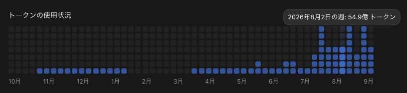
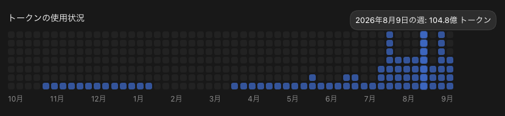
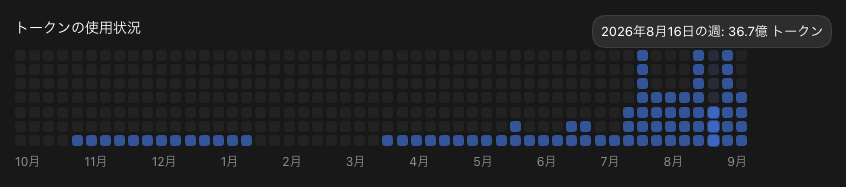
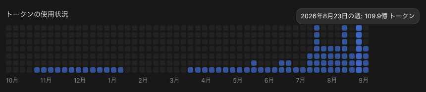
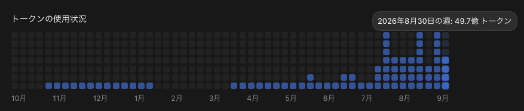
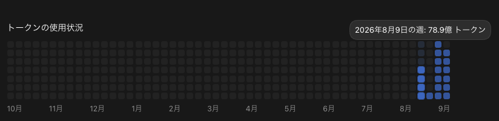
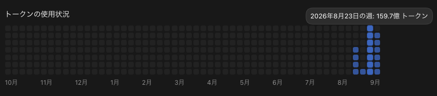
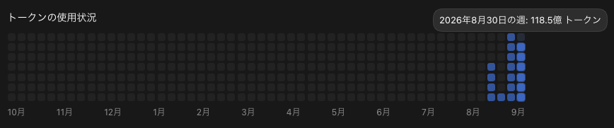
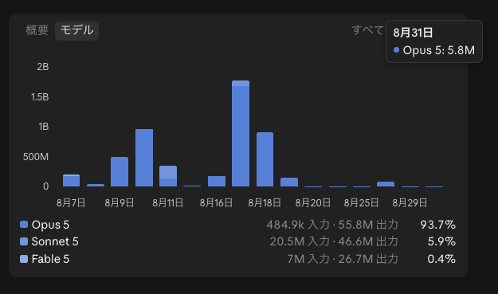

こんにちは、個人開発者のttokunagaです。

今回は、個人開発で利用しているAIサービスの構成と、2026年8月の利用量をAPI料金に換算した金額を公開します。

8月のCodexとClaude Codeで確認できた月間トークン使用量は、合計 **約424.75億トークン** でした。API参考換算額は **\$41,932.91** で、サブスクリプションの支出は、この換算額に対して **約98.99%OFF相当** でした。

## 🤖 2026年8月のAI利用構成

| サービス | サブスク支出 |
| --- | ---: |
| ChatGPT Pro 20X（会社用） | \$200 |
| ChatGPT Pro 20X（個人用） | \$200 |
| Claude Pro | \$22 |
| **合計** | **\$422** |

## 💸 API換算の前提条件

[AI Usage](https://github.com/ttokunaga-ja/aiUsage)で集計しました。Codexの月間総量は公式APIから集計しました。モデル別・入出力別の構成には保存ログを使っています。Claude Codeは8月1日から9月1日までの保存ログを集計しました。

## 📊 Codexの利用量：約361億トークン、API参考換算額:約37,875ドル、割引率:98.9パーセント

Codexの確認できた利用量は **36,146,861,348トークン** です。

### モデル別API換算

モデル別のAPI参考換算は **\$37,874.67** です。

| モデル | トークン数 | API参考換算 |
| --- | ---: | ---: |
| GPT-5.6 Sol | 71,310,229,000 | \$37,874.67 |
| **合計** | **71,310,229,000** | **\$37,874.67** |

### 入出力・キャッシュの割合

ローカルログからCodexの入出力・キャッシュの割合を計算しました。

| 区分 | 割合 |
| --- | ---: |
| 通常入力 | 2.40% |
| キャッシュ入力 | 97.37% |
| 出力 | 0.23% |
| キャッシュ出力 | 0.00% |

### 利用状況の画像

---

## 🤖 Claude Codeの利用量：約63億トークン、API参考換算額:約4,058ドル、割引率:99.5パーセント

Claude Codeの保存ログで確認できた利用量は **6,327,853,747トークン** です。

### モデル別API換算

モデル別のAPI参考換算は **\$4,058.24** です。

| モデル | トークン数 | API参考換算 |
| --- | ---: | ---: |
| Claude Opus 5 | 6,116,172,291 | \$3,882.91 |
| Claude Sonnet 5 | 178,890,247 | \$73.13 |
| Claude Fable 5 | 32,791,209 | \$102.19 |
| **合計** | **6,327,853,747** | **\$4,058.24** |

### 入出力・キャッシュの割合

保存ログからClaude Codeの入出力・キャッシュの割合を計算しました。

| 区分 | 割合 |
| --- | ---: |
| 通常入力 | 0.00% |
| キャッシュ入力 | 98.67% |
| 出力 | 0.22% |
| キャッシュ出力 | 1.11% |

### 利用状況の画像

---

## 📉 API換算額とサブスク支出

| サービス | API参考換算 | サブスク支出 |
| --- | ---: | ---: |
| ChatGPT Pro 20X（2契約） | \$37,874.67 | \$400 |
| Claude Pro | \$4,058.24 | \$22 |
| **合計** | **\$41,932.91** | **\$422** |

:::details 今回使用したモデルのAPI単価（100万トークンあたり、USD）

| モデル | 入力 | キャッシュ入力 | 出力 | キャッシュ出力 |
| --- | ---: | ---: | ---: | ---: |
| GPT-5.6 Sol | \$4 / \$8 | \$0.40 / \$0.80 | \$20 / \$30 | \$5 / \$10 |
| Claude Opus 5 | \$5 | \$0.50 | \$25 | \$6.25 / \$10 |
| Claude Sonnet 5 | \$2 | \$0.20 | \$10 | \$2.50 / \$4 |
| Claude Fable 5 | \$10 | \$1 | \$50 | \$12.50 / \$20 |

GPTの2値は通常／長文、Claudeのキャッシュ出力の2値は5分／1時間の順です。
:::

---

## 📰 2026年8月のAIニュース

### 1位：OpenAI・Anthropicが開発・評価を一時停止

安全性問題を受け、学習やサイバー評価の一部を一時停止し、隔離・監視を強化しました。([OpenAI](https://openai.com/index/pacing-model-development-cyber-capabilities/)、[Anthropic](https://www.anthropic.com/news/improving-alignment-security-efforts))

### 2位：EU AI Actの透明性要件・執行体制が本格適用

8月2日から、AIとの対話の通知や生成コンテンツの識別など、透明性確保の要件が適用されました。([欧州委員会](https://digital-strategy.ec.europa.eu/en/policies/regulatory-framework-ai))

### 3位：NVIDIA、5,000億ドル超のAIインフラ金融構想

8月10日、金融大手6社と、AIインフラへ5,000億ドル超の第三者資金を動員する構想を発表しました。([NVIDIA](https://nvidianews.nvidia.com/news/nvidia-partners-with-apollo-blackrock-blackstone-brookfield-goldman-sachs-and-kkr-to-establish-ai-compute-infrastructure-financing-platforms-to-mobilize-over-500-billion-of-third-party-capital))

### 4位：テキサス州、新規データセンターの接続承認を停止

8月3日、電力・水使用などの監査が完了するまで、新たな接続承認を進めない方針を示しました。([テキサス州知事室](https://gov.texas.gov/news/post/governor-abbott-directs-comprehensive-data-center-audit))

### 5位：SpaceX／Cursor、NVIDIA／Hugging Faceの買収・統合

8月14日にSpaceXのCursor買収が完了し、27日にはNVIDIAのHugging Face買収合意が報じられました。([Cursor](https://cursor.com/blog/joining-spacex)、[Reuters](https://www.reuters.com/technology/nvidia-talks-acquire-hugging-face-13-billion-deal-business-insider-reports-2026-08-27/))

---

## 💡 まとめ

8月はChatGPT Pro 20X（2契約）、Claude Proを合計 **\$422** で利用しました。Codexの確認できた利用量は **約361.47億トークン**、Claude Codeの保存ログは **約63.28億トークン** でした。

## 参考資料

* [OpenAI APIの料金表](https://developers.openai.com/api/docs/pricing)
* [OpenAI APIの変更履歴](https://developers.openai.com/api/docs/changelog)
* [Claudeのモデル別API料金](https://platform.claude.com/docs/en/about-claude/pricing)
* [Claude Proの料金](https://support.claude.com/en/articles/8325606-what-is-the-pro-plan)
* [Claude Maxの料金](https://support.claude.com/en/articles/11049741-what-is-the-max-plan)
