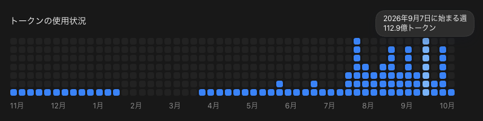
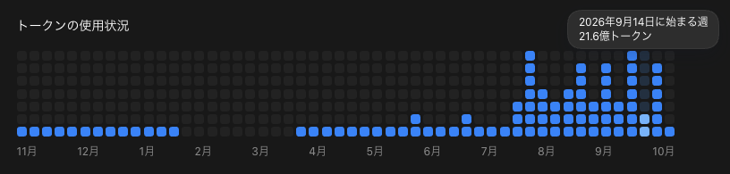
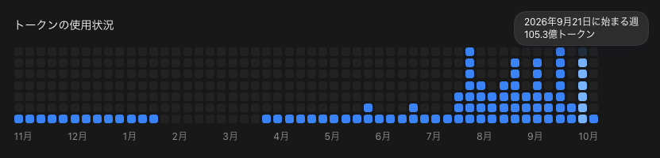
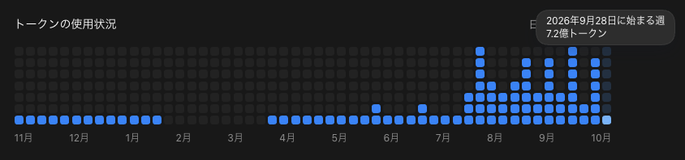
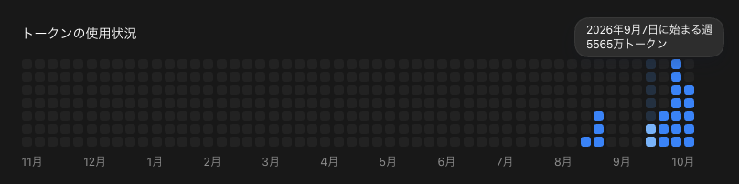
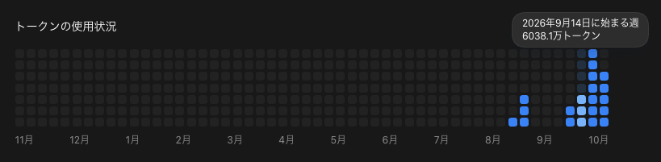
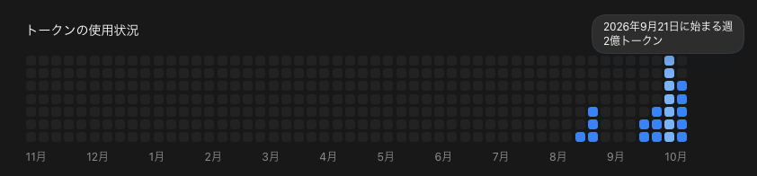
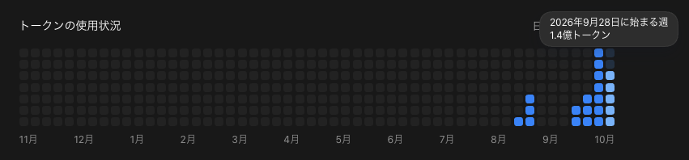

こんにちは、個人開発者のttokunagaです。

今回は、個人開発で利用しているAIサービスの構成と、2026年9月の利用量をAPI料金に換算した金額を公開します。

9月のCodexとClaude Codeで確認できた月間トークン使用量は、合計 **約264.46億トークン** でした。API参考換算額は **\$17,239.93** で、サブスクリプションの支出は、この換算額に対して **約98.60%OFF相当** でした。

## 🤖 2026年9月のAI利用構成

| 利用形態 | サービス | 支出 |
| --- | --- | ---: |
| サブスク | ChatGPT Pro 20X（個人用） | 30,000円 |
| サブスク | ChatGPT Plus（会社用） | 3,000円 |
| サブスク | Claude Pro | \$22（税込） |
| **合計** | — | **36,300円相当** |

## 💸 API換算の前提条件

[AI Usage](https://github.com/ttokunaga-ja/aiUsage)で集計しました。Codexの月間総量は公式APIから集計しました。モデル別・入出力別の構成には保存ログを使っています。Claude Codeは9月1日から10月1日までの保存ログを集計しました。

## 📊 Codexの利用量：約243億トークン、API参考換算額:約16,520ドル、割引率:98.7パーセント

Codexの確認できた利用量は **24,348,406,741トークン** です。

### モデル別API換算

モデル別のAPI参考換算は **\$16,519.91** です。

| モデル | トークン数 | API参考換算 |
| --- | ---: | ---: |
| GPT-5.5 | 267,733,587 | \$180.80 |
| GPT-5.6 Luna | 4,334,033,904 | \$135.53 |
| GPT-5.6 Sol | 4,232,271,146 | \$2,247.87 |
| GPT-5.6 Terra | 18,038,922,741 | \$5,376.27 |
| GPT-6 Astra | 4,895,840,953 | \$6,468.40 |
| GPT-6 Luna | 2,369,658,209 | \$33.28 |
| GPT-6 Sol | 7,435,843,310 | \$2,077.73 |
| GLM 5.3 Flash | 165,716 | \$0.02 |
| **合計** | **41,574,469,566** | **\$16,519.91** |

### 入出力・キャッシュの割合

ローカルログからCodexの入出力・キャッシュの割合を計算しました。

| 区分 | 割合 |
| --- | ---: |
| 通常入力 | 3.09% |
| キャッシュ入力 | 96.57% |
| 出力 | 0.29% |
| キャッシュ出力 | 0.05% |

### 利用状況の画像

---

## 🤖 Claude Codeの利用量：約21億トークン、API参考換算額:約720ドル、割引率:96.9パーセント

Claude Codeの保存ログで確認できた利用量は **2,097,712,118トークン** です。

### モデル別API換算

モデル別のAPI参考換算は **\$720.03** です。

| モデル | トークン数 | API参考換算 |
| --- | ---: | ---: |
| Claude Opus 5 | 118,297,983 | \$105.40 |
| Claude Opus 5.5 | 1,979,414,135 | \$614.63 |
| **合計** | **2,097,712,118** | **\$720.03** |

### 入出力・キャッシュの割合

保存ログからClaude Codeの入出力・キャッシュの割合を計算しました。

| 区分 | 割合 |
| --- | ---: |
| 通常入力 | 0.00% |
| キャッシュ入力 | 98.80% |
| 出力 | 0.24% |
| キャッシュ出力 | 0.96% |

---

## 📉 API換算額とサブスク支出

| サービス | API参考換算 | サブスク支出 |
| --- | ---: | ---: |
| ChatGPT Pro 20X・Plus | \$16,519.91 | 33,000円 |
| Claude Pro | \$720.03 | \$22（税込） |
| **合計** | **\$17,239.93** | **33,000円＋\$22** |

:::details 今回使用したモデルのAPI単価（100万トークンあたり、USD）

| モデル | 入力 | キャッシュ入力 | 出力 | キャッシュ出力 |
| --- | ---: | ---: | ---: | ---: |
| GPT-5.5 | \$5 / \$10 | \$0.50 / \$1 | \$30 / \$45 | — |
| GPT-5.6 Luna | \$0.20 / \$0.40 | \$0.02 / \$0.04 | \$1.20 / \$1.80 | \$0.25 / \$0.50 |
| GPT-5.6 Sol | \$4 / \$8 | \$0.40 / \$0.80 | \$20 / \$30 | \$5 / \$10 |
| GPT-5.6 Terra | \$2 / \$4 | \$0.20 / \$0.40 | \$12 / \$18 | \$2.50 / \$5 |
| GPT-6 Astra | \$10 / \$20 | \$1 / \$2 | \$50 / \$75 | \$12.50 / \$25 |
| GPT-6 Luna | \$0.10 / \$0.20 | \$0.01 / \$0.02 | \$0.50 / \$0.75 | \$0.125 / \$0.25 |
| GPT-6 Sol | \$2 / \$4 | \$0.20 / \$0.40 | \$10 / \$15 | \$2.50 / \$5 |
| GLM 5.3 Flash | \$0.15 | \$0.03 | \$0.50 | \$0 |
| Claude Opus 5 | \$5 | \$0.50 | \$25 | \$6.25 / \$10 |
| Claude Opus 5.5 | \$4 | \$0.20 | \$20 | \$5 / \$8 |

GPTの2値は通常／長文、Claudeのキャッシュ出力の2値は5分／1時間の順です。
:::

---

## 📰 2026年9月のAIニュースと所感

### 1位：Pro 200のナーフと月額500ドルの新プラン

9月29日、OpenAIは月額500ドルのPro 500を発表しました。Astra Ultrafastが使える一方、月額200ドルのPro 200は価格据え置きで利用枠が縮小します。対象の既存契約は10月29日まで従来の枠を維持できますが、その後は新しい枠へ移ります。([公式発表](https://help.openai.com/en/articles/6825453-chatgpt-release-notes)、[Proの料金・移行条件](https://help.openai.com/en/articles/9793128-about-chatgpt-pro-tiers))

今回の利用枠縮小を受けて、Claude Codeに一部の開発を移行することを前向きに検討しています。

### 2位：Claude Pro、iOSなら月額3,000円だった

私がWebで払っていたClaude Proは **税込22ドル** で、円換算の目安は約3,600円です。一方、日本の[App Store](https://apps.apple.com/jp/app/claude-by-anthropic/id6473753684)では、Proの月額が **3,000円** になっています。

同じProなのに購入経路で月に約600円違うと知って、今までWebで払い続けていた自分は損していたと感じました。iOS経由ではAppleの手数料がかかるはずなのに、Webで直接支払うより安いのは謎です。モデルのAPI単価だけでなく、サブスクをどこで買うかまで見ておくべきでした。

### 3位：GPT-6 Sol・Lunaで日常作業の単価が下がった

9月22日、OpenAIはGPT-6 SolとLunaを公開しました。通常入力・出力のAPI単価は、100万トークンあたりSolが2ドル・10ドル、Lunaが0.10ドル・0.50ドルです。重い作業と日常的な作業を分ける意味が、さらに大きくなりました。([公式発表](https://openai.com/index/introducing-gpt-6-sol-and-luna/))

### 4位：Claude Opus 5.5、キャッシュ読み取りが60%安く

9月22日、AnthropicはOpus 5.5を公開しました。通常入力・出力はOpus 5より20%安く、キャッシュ読み取りは100万トークンあたり0.50ドルから0.20ドルへ下がりました。キャッシュを多く読む私の使い方では、この値下げが効きます。([公式発表](https://www.anthropic.com/claude-opus-5-5))

### 5位：Codex CloudでPCが眠っていても作業を継続

9月29日、Codex Cloudが発表されました。デスクトップ・Web・モバイルからタスクを開始・継続でき、PCがスリープ中でも作業が進みます。長い処理を任せて別のことをする使い方が、さらにしやすくなりました。([公式発表](https://help.openai.com/en/articles/6825453-chatgpt-release-notes))

---

## 💡 まとめ

2026年9月は、個人用のChatGPT Pro 20Xを30,000円、会社用のChatGPT Plusを3,000円で利用し、Claude Proは税込22ドルでした。比較用レートでは、サブスク支出は **36,300円相当** です。

Codexの確認できた利用量は **約243.48億トークン**、Claude Codeの保存ログは **約20.98億トークン** でした。

## 参考資料

* [OpenAI APIの標準料金](https://developers.openai.com/api/docs/pricing)
* [Z.AIのモデル別料金](https://docs.z.ai/guides/overview/pricing)
* [ChatGPT Proのプランと利用枠](https://help.openai.com/en/articles/9793128-about-chatgpt-pro-tiers)
* [ClaudeのApp Store価格](https://apps.apple.com/jp/app/claude-by-anthropic/id6473753684)
* [Claudeのモデル別API料金](https://platform.claude.com/docs/en/about-claude/pricing)
* [2026年7月のAI利用構成とAPI換算額](https://zenn.dev/t_tokunaga/articles/2026-08-01-ai-model-stack-cost-breakdown-2026-07)
* [2026年8月のAI利用構成とAPI換算額](https://zenn.dev/t_tokunaga/articles/2026-09-01-ai-model-stack-cost-breakdown-2026-08)
