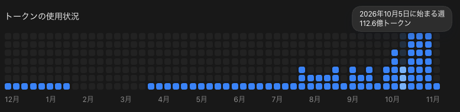
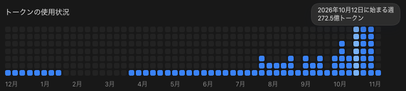
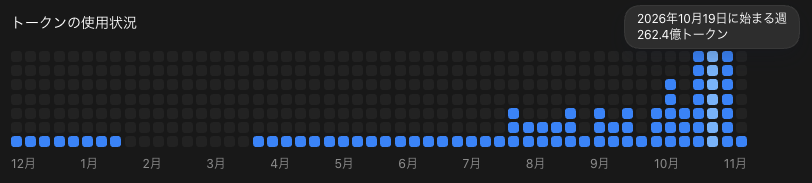
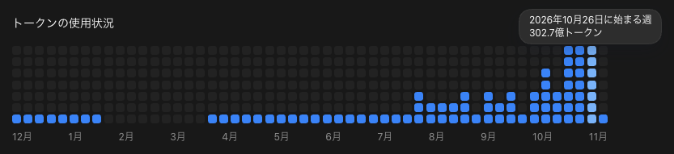

こんにちは、個人開発者のttokunagaです。

今回は、個人開発で利用しているAIサービスの構成と、2026年10月の利用量をAPI料金に換算した金額を公開します。

10月のCodexとClaude Codeで確認できた月間トークン使用量は、合計 **約1,273.30億トークン** でした。API参考換算額は **\$23,784.56** で、サブスクリプションの支出は、この換算額に対して **約98.80%OFF相当** でした。

## 🤖 2026年10月のAI利用構成

| サービス | サブスク支出 |
| --- | ---: |
| ChatGPT Pro 20X | \$200 |
| ChatGPT Plus | \$20 |
| Claude Pro（\$22 × 3契約） | \$66 |
| **合計** | **\$286** |

## 💸 API換算の前提条件

[AI Usage](https://github.com/ttokunaga-ja/aiUsage)で集計しました。Codexは公式APIの日別総量と残存ログを集計し、重複する記録を1回だけ数えました。モデル別・入出力別の構成には保存ログを使っています。Claude Codeは保存ログから集計しました。CodexはUTC、Claude Codeは日本時間で10月1日から11月1日までを対象にしています。

## 📊 Codexの利用量：約1,165億トークン、API参考換算額:2万ドル、割引率:98.9パーセント

Codexの確認できた利用量は **116,532,527,622トークン** です。

### 入出力・キャッシュの割合

ローカルログからCodexの入出力・キャッシュの割合を計算しました。

| 区分 | 割合 |
| --- | ---: |
| 通常入力 | 2.01% |
| キャッシュ入力 | 97.70% |
| 出力 | 0.28% |
| キャッシュ出力 | 0.00% |

モデル別のAPI参考換算は **\$20,332.07** です。Daybreak BlueにはベースモデルであるGPT-5.6 Solの単価を使用しました。

保存ログの構成比を公式総量に配分したモデル別のAPI参考換算です。

| モデル | トークン数 | API参考換算 |
| --- | ---: | ---: |
| GPT-6 Astra | 52,878,777 | \$75.12 |
| GPT-6 Luna | 6,932,434,692 | \$104.56 |
| GPT-6 Sol | 14,786,340,301 | \$3,688.21 |
| GPT-6.1 Sol | 77,462,083,534 | \$15,131.73 |
| GPT-6.1 Terra | 12,589,136,602 | \$1,151.99 |
| Daybreak Blue | 276,787,124 | \$180.47 |
| **合計** | **112,099,661,030** | **\$20,332.07** |

### 利用状況の画像

---

## 🤖 Claude Codeの利用量：約108億トークン、API参考換算額:約3,452ドル、割引率:98.1パーセント

Claude Codeの保存ログで確認できた利用量は **10,797,316,127トークン** です。

### モデル別API換算

モデル別のAPI参考換算は **\$3,452.49** です。保存ログから集計しました。

| モデル | トークン数 | API参考換算 |
| --- | ---: | ---: |
| Claude Opus 5.5 | 10,771,306,207 | \$3,446.95 |
| Claude Sonnet 5.5 | 26,009,920 | \$5.54 |
| **合計** | **10,797,316,127** | **\$3,452.49** |

### 入出力・キャッシュの割合

保存ログからClaude Codeの入出力・キャッシュの割合を計算しました。

| 区分 | 割合 |
| --- | ---: |
| 通常入力 | 0.00% |
| キャッシュ入力 | 98.71% |
| 出力 | 0.17% |
| キャッシュ出力 | 1.12% |

---

## 📉 API換算額とサブスク支出

| サービス | API参考換算 | サブスク支出 |
| --- | ---: | ---: |
| ChatGPT Pro 20X・Plus | \$20,332.07 | \$220 |
| Claude Pro（\$22 × 3契約） | \$3,452.49 | \$66 |
| **合計** | **\$23,784.56** | **\$286** |

:::details 今回使用したモデルのAPI単価（100万トークンあたり、USD）

| モデル | 入力 | キャッシュ入力 | 出力 | キャッシュ出力 |
| --- | ---: | ---: | ---: | ---: |
| GPT-6 Astra | \$10 / \$20 | \$1 / \$2 | \$50 / \$75 | \$12.50 / \$25 |
| GPT-6 Luna | \$0.10 / \$0.20 | \$0.01 / \$0.02 | \$0.50 / \$0.75 | \$0.125 / \$0.25 |
| GPT-6 Sol | \$2 / \$4 | \$0.20 / \$0.40 | \$10 / \$15 | \$2.50 / \$5 |
| GPT-6.1 Sol | \$2 / \$4 | \$0.10 / \$0.20 | \$10 / \$15 | \$2.50 / \$5 |
| GPT-6.1 Terra | \$1 / \$2 | \$0.05 / \$0.10 | \$5 / \$7.50 | \$1.25 / \$2.50 |
| Daybreak Blue（GPT-5.6 Sol単価） | \$4 / \$8 | \$0.40 / \$0.80 | \$20 / \$30 | \$5 / \$10 |
| Claude Opus 5.5 | \$4 | \$0.20 | \$20 | \$5 / \$8 |
| Claude Sonnet 5.5 | \$2 | \$0.10 | \$10 | \$2.50 / \$4 |

GPTの2値は通常／長文、Claudeのキャッシュ出力の2値は5分／1時間の順です。
:::

---

## 📰 2026年10月のAIニュースと所感

### 1位：CodexとChatGPT Workのキャッシュを永久保持

10月21日、OpenAIのTiboは、ログインして利用するCodexとChatGPT Workではキャッシュを永久に保持し、古い会話や数時間後の再開でもキャッシュを利用できると説明しました。長時間の作業を再開しやすくなる変更です。([Tiboの投稿](https://x.com/thsottiaux/status/2112712984644784534))

### 2位：Tiboの28日間チャレンジが終了

Tiboが10月5日から続けた28日間のチャレンジは、11月1日に終了しました。CodexやChatGPT Workに関係する改善、または利用枠のリセットを毎日届ける取り組みでした。([チャレンジの記録](https://whenresets.cc/codex-28-days/))

### 3位：GPT-6.1 TerraがCodexに登場

10月26日にGPT-6.1 Terraが公開され、Codexでも利用できるようになりました。画像の理解や画面操作に対応し、今回の集計でも利用が記録されています。([OpenAIの更新履歴](https://developers.openai.com/api/docs/changelog)、[ChatGPTの更新情報](https://learn.chatgpt.com/docs/whats-new/october-26-30-2026))

### 4位：Claude Haiku 5.5が公開

Anthropicは10月7日にClaude Haiku 5.5を公開しました。小型モデルの選択肢が増え、大量の処理やサブエージェントに合わせてモデルを選びやすくなりました。([Anthropicのモデル発表一覧](https://www.anthropic.com/news/models))

### 5位：GPT-6.1 SolにUltrafastモード

10月5日〜9日の更新で、CodexとChatGPT WorkのGPT-6.1 SolにUltrafastモードが追加されました。利用できるプランには条件があります。([ChatGPTの更新情報](https://learn.chatgpt.com/docs/whats-new/october-5-9-2026))

---

## 💡 まとめ

10月はChatGPT Pro 20X、ChatGPT Plus、Claude Pro（\$22 × 3契約）を合計 **\$286** で利用しました。Codexの確認できた利用量は **約1,165.33億トークン**、Claude Codeの保存ログは **約107.97億トークン** でした。

## 参考資料

- [OpenAI API料金](https://developers.openai.com/api/docs/pricing)
- [Claude API料金](https://platform.claude.com/docs/en/about-claude/pricing)
- [Codex app-serverの利用量API](https://learn.chatgpt.com/docs/app-server#7-token-usage-chatgpt)
- [2026年9月のAI利用構成とAPI換算額](https://zenn.dev/t_tokunaga/articles/2026-10-01-ai-model-stack-cost-breakdown-2026-09)
